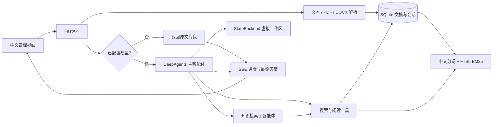

# 架构说明

## 数据与索引

`spaces → documents → chunks` 保存知识库、原文与片段。分片长度 900 字符、重叠 120 字符；中文通过 jieba 搜索分词，使用 FTS5 BM25 排序，标题权重为正文的三倍。没有嵌入模型、外部向量数据库或网络索引依赖。

新建、修改、删除文档在同一 SQLite 事务中维护片段和 FTS 表，避免孤立或陈旧索引。WAL 模式支持本地读写。检索结果返回片段、文档 ID 与标题，不把 BM25 排名当作概率或准确率。

`conversations → messages` 按知识库保存历史，只在回答成功后一次性提交用户和助手消息。未来删除或编辑原文会改变引用链接对应的内容；引用不是不可变的文档版本快照。

## 智能体执行

使用固定版本 `deepagents==0.7.23` 的 `create_deep_agent`，显式传入 `ChatOpenAI`，通过兼容 Chat Completions 接口连接模型。SDK 提供规划、子智能体、上下文管理与虚拟文件工具。模型可在复杂问题中调用 `task`，委派给 `knowledge-researcher`，该子智能体持有同样的知识库范围约束。

`search_knowledge(query)` 和 `read_document(document_id, offset)` 通过服务器闭包绑定当前知识库；模型不能选择其他知识库 ID。读取原文每次最多 6000 字符。`StateBackend()` 是虚拟状态文件系统，不挂载宿主目录，不提供 shell 执行能力。

最近六轮完成的问答进入上下文，旧引用必须重新检索。工具实际读取的文档进入本次证据集合；答案中的 `[资料:文档ID]` 仅能映射到本次证据。非法文档 ID 引用标为「未核实引用」，没有检索行为的回答不作为知识问答展示。该校验确认引用访问来源，不证明模型的每句结论都被证据支持，仍需用户核对。

SDK 图是每次请求新建的；历史由应用数据库管理。此版本没有 LangGraph 持久化 checkpointer，因此任务中断不会恢复中间图状态。

## 文档关联

`document_links` 保存链接原文、来源文档、目标 ID、锚点、显示文字、Unicode 位置和引用片段；`document_aliases` 保存别名。启动时通过 `schema_meta` 标记执行一次既有文档回填；不改写 Markdown 原文。后续文档、全文索引和链接索引在同一事务中更新。

仅唯一匹配的未绑定链接会自动解析。目标重命名时保留其稳定 ID，并将旧标题添加为别名。目标删除时外键清空当前 ID，另保留原绑定记录，因此不会被同名新文档静默替代；用户可以明确重新绑定。重新索引来源文档时按原始链接文字和出现次序保留已有绑定。链接从原文删除后再次插入则按新链接处理。

所有解析、手动绑定、反向引用和图查询都限制在同一知识库。显式 `id:` 链接同样检查范围。同名标题或别名匹配多个文档时返回候选项，不任选目标。图遍历按有向链接的双向邻接进行一至两层 BFS，返回边仍保留引用方向；重复引用合为一条边并记录次数。查询限制节点与边数量，API 返回截断标记。

前端使用服务器索引位置渲染可点击链接，显式处理 Python Unicode 码点与 JavaScript UTF-16 的差异。文本通过 DOM `textContent` 输出；Cytoscape.js 在本地静态资源中打包，保留 MIT 许可证并验证 npm 包完整性。代码、注释和转义标记不参与关联；图谱不做语义相似度推断。

新增 API：`GET /api/spaces/{space_id}/documents/{id}/relations`、`GET .../{id}/graph?depth=1|2`、`PUT .../{id}/links/{link_id}`（JSON `target_id`）。智能体关联工具返回链接上下文，但不会把图节点自动加入答案证据集合；需调用阅读工具核实内容。

## 本地服务

FastAPI 同时提供 REST、SSE 和静态资源。前端不从 CDN 拉取依赖，用户文本和模型输出通过转义或 DOM `textContent` 展示，不执行上传 HTML。文件不写入用户提供的路径；解析后仅保存文本。默认监听本机，未实现身份认证。

导入限制涵盖上传大小、提取字符数、PDF 页数、DOCX 解压总大小。解析仍在服务进程的工作线程中执行；处理不可信的大规模文件需要后续独立任务队列和资源隔离。当前面向可信单用户本地使用。

## 后续扩展方向

- 团队使用：认证、RBAC、审计日志、租户配额。
- 更大语料：后台导入任务、嵌入模型、向量/词法混合召回和重排。
- Wiki 产品：树形文档、版本历史、独立阅读站、发布流程。
- 智能体能力：AI 创作、持续任务检查点、流式 token、人工审批。
- 数据来源：OCR、受限 URL 抓取、Sitemap/RSS、第三方平台连接。
