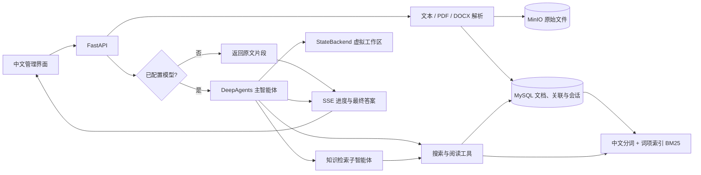

# 架构说明

## 数据与索引

支持 MySQL 5.7 和 8.x。表使用 InnoDB、utf8mb4_bin 和 DYNAMIC 行格式，支持长对象键与中文词项的索引；MySQL 5.7 需保留 InnoDB large-prefix 支持。检索 SQL 不依赖窗口函数或其他 MySQL 8 专属语法。

`spaces → documents → chunks` 保存知识库、原文与片段。分片长度 900 字符、重叠 120 字符；中文通过 jieba 搜索分词，使用 词项索引 BM25 排序，标题权重为正文的三倍。不依赖嵌入模型或向量数据库。短中文词不受 MySQL FULLTEXT 的词长或默认停用词限制。

新建、修改、删除文档在同一 MySQL InnoDB 事务中维护片段、词项表和关联，避免孤立或陈旧索引。连接按操作创建并关闭，不在线程间共享。检索结果返回片段、文档 ID 与标题，不把 BM25 排名当作概率或准确率。

`conversations → messages` 按知识库保存历史，只在回答成功后一次性提交用户和助手消息。未来删除或编辑原文会改变引用链接对应的内容；普通文档引用不是不可变快照；代码引用独立保留对应提交的源码快照。

## 原件与跨存储一致性

`original_files` 保存对象键、文件名、大小、内容类型与 SHA-256；对象路径由知识库 ID 和随机 UUID 生成，同名上传互不覆盖。文档 API 只返回公开文件元数据，不返回存储密钥或对象键。下载 API 先验证文档所在知识库，再通过 MinIO SDK 流式返回原件，关闭连接并强制作为附件下载。正文编辑保留导入原件；Markdown 导出始终返回当前正文。

MySQL 与 MinIO 不共享事务。上传前先在 MySQL `object_deletions` 预留一小时后清理的对象键，再上传原件，最后在文档事务中关联原件并撤销清理任务。异常时提前清理未关联对象；进程中断或网络故障遗留的任务由后续工作线程重试。每次清理会排除已关联的对象，避免提交结果不明确时误删已保存原件。删除文档和知识库时，元数据删除与对象清理任务同事务提交，应用每 60 秒重试原件删除。MinIO 暂不可用时原件清理延迟，不声称跨系统原子事务。

`.env` 通过 Pydantic Settings 读取，环境变量优先。密码类型使用 `SecretStr`，状态接口仅提供存储类型；SDK 存储错误统一返回 503，不将服务端连接详情返回浏览器。应用启动必须连通两项服务；`/api/health` 同时验证两项服务可用。TLS 使用正常的证书校验。

SQLite 迁移显式运行，只读源文件，目标必须为空。迁移保留原有文档/关联/消息 ID，重建词项索引；数据库写入在单个事务中完成。历史原件无法从旧版仅提取的正文还原。

## 智能体执行

使用固定版本 `deepagents==0.7.23` 的 `create_deep_agent`，显式传入 `ChatOpenAI`，通过兼容 Chat Completions 接口连接模型。SDK 提供规划、子智能体、上下文管理与虚拟文件工具。模型可在复杂问题中调用 `task`，委派给 `knowledge-researcher`，该子智能体持有同样的知识库范围约束。

`search_knowledge(query)` 和 `read_document(document_id, offset)` 通过服务器闭包绑定当前知识库；模型不能选择其他知识库 ID。读取原文每次最多 6000 字符。`StateBackend()` 是虚拟状态文件系统，不挂载宿主目录，不提供 shell 执行能力。

最近六轮完成的问答进入上下文，旧引用必须重新检索。工具实际读取的文档进入本次证据集合；答案中的 `[资料:文档ID]` 仅能映射到本次证据。非法文档 ID 引用标为「未核实引用」，没有检索行为的回答不作为知识问答展示。该校验确认引用访问来源，不证明模型的每句结论都被证据支持，仍需用户核对。

SDK 图是每次请求新建的；历史由应用数据库管理。此版本没有 LangGraph 持久化 checkpointer，因此任务中断不会恢复中间图状态。

## 文档关联

`document_links` 保存链接原文、来源文档、目标 ID、锚点、显示文字、Unicode 位置和引用片段；`document_aliases` 保存别名。启动时通过 `schema_meta` 标记执行一次既有文档回填；不改写 Markdown 原文。后续文档、全文索引和链接索引在同一事务中更新。

仅唯一匹配的未绑定链接会自动解析。目标重命名时保留其稳定 ID，并将旧标题添加为别名。目标删除时外键清空当前 ID，另保留原绑定记录，因此不会被同名新文档静默替代；用户可以明确重新绑定。重新索引来源文档时按原始链接文字和出现次序保留已有绑定。链接从原文删除后再次插入则按新链接处理。

所有解析、手动绑定、反向引用和图查询都限制在同一知识库。显式 `id:` 链接同样检查范围。同名标题或别名匹配多个文档时返回候选项，不任选目标。图遍历按有向链接的双向邻接进行一至两层 BFS，返回边仍保留引用方向；重复引用合为一条边并记录次数。查询限制节点与边数量，API 返回截断标记。

前端使用服务器索引位置渲染可点击链接，显式处理 Python Unicode 码点与 JavaScript UTF-16 的差异。文本通过 DOM `textContent` 输出；Cytoscape.js 在本地静态资源中打包，保留 MIT 许可证并验证 npm 包完整性。代码、注释和转义标记不参与关联；图谱不做语义相似度推断。

新增 API：`GET /api/spaces/{space_id}/documents/{id}/relations`、`GET .../{id}/graph?depth=1|2`、`PUT .../{id}/links/{link_id}`（JSON `target_id`）。智能体关联工具返回链接上下文，但不会把图节点自动加入答案证据集合；需调用阅读工具核实内容。

## 本地服务

FastAPI 同时提供 REST、SSE 和静态资源。前端不从 CDN 拉取依赖，用户文本和模型输出通过转义或 DOM `textContent` 展示，不执行上传 HTML。文件不写入用户提供的路径；正文存入 MySQL，原件存入私有 MinIO bucket，通过服务器流式下载；文件名只用于元数据和下载响应，不作为对象路径。默认监听本机，未实现身份认证。

导入限制涵盖上传大小、提取字符数、PDF 页数、DOCX 解压总大小。解析仍在服务进程的工作线程中执行；处理不可信的大规模文件需要后续独立任务队列和资源隔离。当前面向可信单用户本地使用。

## 后续扩展方向

- 团队使用：认证、RBAC、审计日志、租户配额。
- 更大语料：后台导入任务、嵌入模型、向量/词法混合召回和重排。
- Wiki 产品：树形文档、版本历史、独立阅读站、发布流程。
- 智能体能力：AI 创作、持续任务检查点、流式 token、人工审批。
- 数据来源：OCR、受限 URL 抓取、Sitemap/RSS、第三方平台连接。

## 代码仓库与 Wiki

`repositories` 保存来源类型、地址、分支和任务状态；`repository_snapshots` 记录提交号及 MinIO 中不可变的过滤后 tar.gz；`repository_documents` 将当前源码与生成 Wiki 映射到正常文档索引。同一仓库、类型和文件路径保持文档 ID；删除路径清理旧索引。源码字符串中的 `[[...]]` 不参与双向链接，生成 Wiki 使用显式文档 ID 链接。

GitLab 同步在隔离临时目录浅克隆指定分支；本地仓库直接读取对象库，不启动 upload-pack。使用 `ls-tree` / `cat-file` 读取提交树；不 checkout、不运行仓库代码、hook、构建脚本或子模块。GitLab 地址受 `.env` 的固定 origin/base path 约束，本地目录受解析后的允许根目录约束。Git 全局配置和系统配置隔离，凭据 helper 清空，askpass 仅持有子进程环境凭据，TLS 正常校验。

MinIO 上传前预留清理任务；快照关联、源码/Wiki 更新、索引刷新和仓库当前指针在同一个 MySQL 事务中提交。失败保留上一次可用版本；清理同时排除原件与源码快照中已关联的对象。历史快照保留至仓库删除，不会因重同步失效。源码下载通过当前知识库和仓库联合授权查询，不把对象键返回浏览器，也不向文件系统解压 tar。返回最多 500 行源码，前端转义内容并显示行号。

持久化队列由单进程串行 worker 处理同步或 AI Wiki；繁忙仓库拒绝重复任务和删除，启动时将中断任务标为可重试失败。正常关机等待当前仓库任务结束。此队列不是分布式队列，不支持多 worker 部署。

AI Wiki 复用 DeepAgents 的规划、研究子智能体与虚拟 StateBackend，但所有检索工具通过 RepositoryScope 限制在选定仓库的源码，不读取生成的 Wiki 页面。输出必须引用本次检索或阅读的有效源码 ID；引用解析兼容空格、中文冒号、已读取文件路径与行号标记，仅对本次非空源码证据进行匹配。校验失败会携带具体原因和有效引用列表，沿原图消息历史进行一次修正，共用原任务超时；失败不覆盖已保存页面。源码引用转换为 Wiki 链接，页首记录提交号。源码引用检查不证明模型的结论正确。仓库内容会经工具结果发送给配置的模型；文件过滤不等同于完整秘密扫描。
